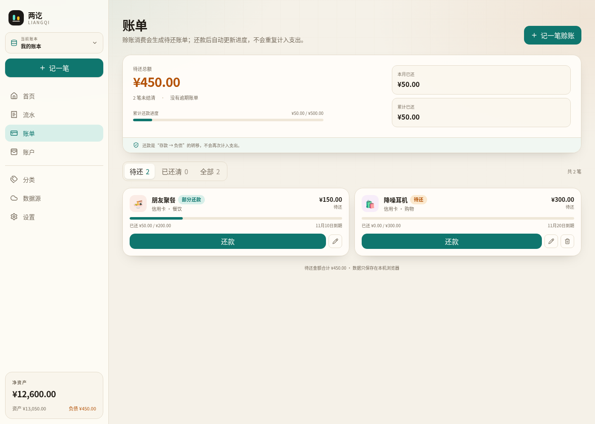
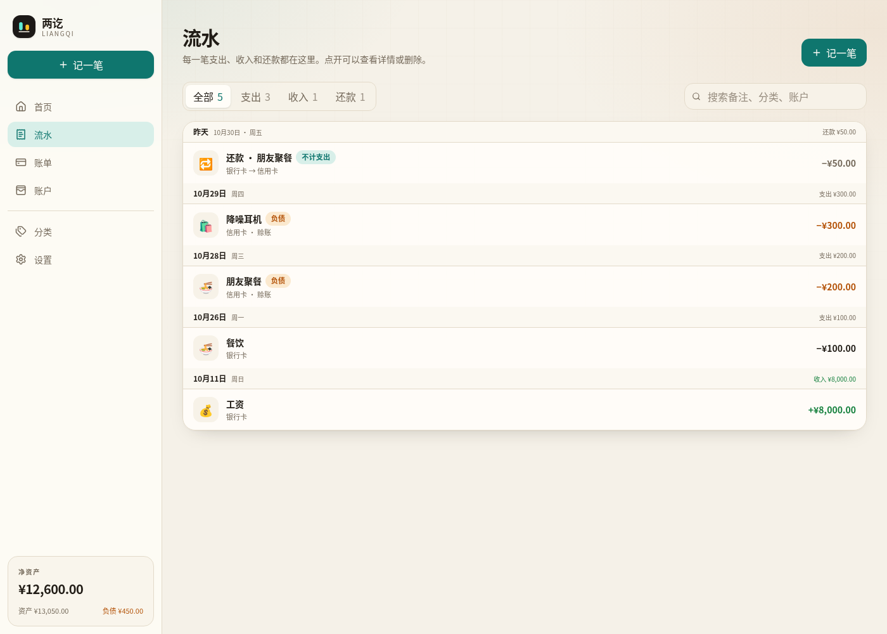

# Liangqi · 两讫

> Clear accounts, settled debts.

**Languages:** [简体中文](README.md) · [繁體中文](README.zh-TW.md) · **English** · [日本語](README.ja.md) · [한국어](README.ko.md) · [Español](README.es.md) · [Français](README.fr.md) · [Deutsch](README.de.md) · [Português](README.pt.md) · [Русский](README.ru.md)

**Live app:** https://arksc.cn:8002/workbook/  
**Source:** [Gitee](https://gitee.com/PharaohMan/liangqi-app) · [GitHub](https://github.com/yejunhui/liangqi-app)  
**License:** AGPL-3.0-or-later · **AI / developer context:** [AGENTS.md](AGENTS.md)

Liangqi is a **local-first shared-ledger web app** that keeps cash spending and credit purchases separate:

- **Cash spending** is deducted from savings immediately.
- **Credit purchases** do not touch savings. They count as expenses immediately and increase liabilities; repayment later reduces savings, liabilities, and disposable assets without counting the expense again.

Data lives in the browser by default. Multiple books are supported. Connect a GitHub, Gitee, or WebDAV repository to share one book with multiple members. When a remote is connected, Liangqi reads remote data first and falls back to local data offline.


## The problem it solves

Most bookkeeping apps only record "how much was spent". In reality:

> Dinner was paid by credit card. The money is still in the bank, but the expense has already happened.

Liangqi separates the three events:

| Action | Assets / savings | Liabilities | Expense |
| --- | ---: | ---: | ---: |
| Cash purchase | −100 | 0 | +100 |
| Credit purchase | 0 | +100 | +100 |
| Repayment | −100 | −100 | 0 |
| Loan received | +100 | +100 | 0 |

Key rules:

- A credit purchase counts as an expense when recorded and increases liabilities, but does not touch savings; **disposable assets stay unchanged**.
- Repayment moves value from assets to liabilities and reduces disposable assets, but **does not count the expense again**.
- Net worth = total assets − total liabilities. A credit purchase lowers net worth when recorded because liabilities increase; repayment does not change net worth.

## Features

- **Multiple books**: keep family, travel, and business books in one local library and switch between them.
- **Asset and liability accounts**: cash, bank cards, credit cards, Huabei, loans, and more, with opening balances. Asset accounts can be marked as liquid or not.
- **Overview**: total assets, total liabilities, disposable assets, and net worth.
- **Two spending modes**: deduct from savings now, or count the expense immediately and create a liability and bill to repay later.
- **Bills**: name, category, due date, partial repayment, and paid status.
- **Repayments**: repay from an asset account; liabilities and savings are reduced. The expense was already counted at purchase time, so repayment does not count it again. A direct repayment is applied automatically to the oldest open bill for that liability account.
- **Transfers**: move money between asset accounts without affecting income, expenses, or budgets.
- **Member attribution**: bills and entries can belong to a family member; member labels appear on cards and lists.
- **Tags and tag groups**: built-in daily tag groups for life context, purpose, and related people; single- or multi-select tags, plus your own tags.
- **Two-level categories**: expense and income categories can have parents, such as Food / Lunch; statistics and budgets include child categories.
- **Budgets**: monthly or yearly budgets by category, tag, or member, with progress and overspend warnings; smart suggestions based on the last three months.
- **Recurring entries**: rent, salary, subscriptions, and other rules by day, week, month, or year; pause or post due entries manually.
- **CSV import**: WeChat, Alipay, and bank CSV files with automatic header detection, preview, and category matching.
- **Multi-currency entries**: choose a foreign currency, fetch a live rate, or override it manually; balances and reports stay in the base currency while the original amount is preserved.
- **Attachments**: receipts, invoices, and screenshots up to 10 MB; files live in local IndexedDB and sync to the remote repository on demand.
- **Quick entry**: type or say "lunch yesterday 35 cash" and let the app detect amount, category, account, and date. Optional OpenAI-compatible AI parsing handles more complex sentences.
- **AI assistant**: with an OpenAI-compatible endpoint, ask questions about monthly spending, 12-month trends, categories, tags, members, budgets, and outstanding bills; get budget advice and annual summaries.
- **Location and map**: record a location with an entry and view spending footprints on OpenStreetMap.
- **Batch editing**: select multiple entries and change category, member, or tags together.
- **Local password**: optional PBKDF2-hashed local lock; the hash stays on this device.
- **Analytics**: net worth, monthly spending and income, outstanding and overdue amounts, category shares, 7-day trend, budget progress, 6-month trends, tag/member breakdowns, large expenses, multi-dimensional filters, and saved analysis views.
- **Reports**: export filtered results as CSV or generate a printable PDF monthly report.
- **PWA**: install on desktop or phone; the service worker caches the app shell for offline opening.
- **Remote sources**: GitHub, Gitee, and WebDAV. **One repository stores one shared book**; everyone connecting to the same repository enters the same book.
- **Members and authorship**: multiple people can share one GitHub/Gitee token. After connecting, each person selects their member and enters their password. Member passwords are required for shared books; PBKDF2 hashes are written to `meta.json`. Entries and bills record their author; other members can view but cannot edit or delete them. The member list syncs to the repository.
- **Incremental merge**: entries and bills are merged by id, and fields are merged by `fieldUpdatedAt`. Tombstones prevent deleted records from coming back.
- **Local-first, remote-first reads**: writes go to local storage immediately; opening a connected book pulls remote first and falls back to local offline. The cloud badge on the dashboard shows local, pending, syncing, synced, offline, or failed.
- **Chunked sync**: read `manifest.json` first and skip unchanged chunks; reuse cached chunks by hash; upload only changed chunks.
- **Conflict backups**: before overwriting, the local version is saved and can be downloaded as JSON.
- **Backups**: export a single book or the whole library; GitHub/Gitee commit history provides another copy.
- **Ten UI languages**: Simplified Chinese, Traditional Chinese, English, Japanese, Korean, Spanish, French, German, Portuguese, and Russian.
- **Dark mode and responsive layout**: light, dark, or system; desktop sidebar and mobile bottom navigation.

| Bills | Entries |
| --- | --- |
|  |  |

## Remote repository layout

One repository stores one shared book:

```text
repo/
└── liangqi/
    ├── meta.json          # accounts, categories, tags, budgets, recurring rules, members, settings, book info, tombstones
    ├── manifest.json      # chunk list, hashes, counts
    ├── entries-0.json     # entries 0–999
    ├── entries-1000.json  # entries 1000–1999
    ├── bills-0.json       # bill chunks
    └── attachments/       # attachment files (base64 JSON, downloaded on demand)
```

Each chunk holds up to 1000 records by default. `manifest.json` records each chunk's start, count, and content hash.

The older multi-book layout (`liangqi/index.json` + `liangqi/books/<bookId>/`) is still readable; the first sync writes the new single-book root layout. The legacy single-file `books/<bookId>.json` format is also readable. If an old repository contains multiple books, only the currently bound book is migrated; the others remain in the repository but do not appear in the new shared-book list.

Multiple people can share one token. After connecting, each person selects their own member and enters a password. New entries and bills record that member as the author. Member records and password hashes live in the book's `meta.json` and sync to every device. Shared books require member passwords. After login, you cannot simply switch to another member; use **Current member → Switch user / Lock**, which returns to the member list. The last used member is listed first. New entries, bills, and recurring rules default to the logged-in member.

## Sync rules

- **Immediate local write**: every change goes to IndexedDB first and the UI updates immediately; localStorage is a fallback mirror.
- **Incremental pull**: read `manifest.json` to detect changes, then skip `meta.json` and all chunks when nothing changed; reuse local chunks by hash.
- **Automatic push**: local changes are pushed after about 1.8 seconds; failures do not block bookkeeping.
- **Chunked upload**: only chunks whose hashes changed are uploaded. GitHub uses the Git Data API to combine several chunks into one commit; Gitee and WebDAV write files individually.
- **Record-level merge**: entries and bills are merged by id, preserving additions from both sides. Fields such as title, note, category, member, tags, and attachments are resolved by `fieldUpdatedAt`.
- **Tombstones**: deleting entries/bills writes `deletedEntries` / `deletedBills`; deleting accounts, categories, tags, members, budgets, recurring rules, or attachments writes `deletedConfig`. Other devices apply the deletion instead of resurrecting old copies.
- **Author protection**: entries, bills, recurring rules, and attachments record an author id. Non-authors can view but cannot edit or delete them. Repayments and new entries are not blocked.
- **Shared configuration**: accounts, categories, tags, members, budgets, recurring rules, and attachments are shared book configuration merged by id. For accounts, categories, and tags, a duplicate id takes the remote version. Members merge by `updatedAt` / `fieldUpdatedAt` so an old copy cannot overwrite a newer password. Tombstones are applied.
- **Conflict backup**: if both local and remote changed before a write, the local version is saved under **Data source → Conflict backups**, up to 10 copies.
- **Offline fallback**: keep using local data when the remote is unavailable; merge and push automatically when it returns.

## Deployment

A detailed, beginner-friendly deployment guide is in **[docs/deployment.md](docs/deployment.md)** (currently in Chinese). It covers:

- Using the hosted app and installing the PWA
- Netlify Drop / Cloudflare Pages / Gitee Pages
- Nginx + HTTPS on your own server
- Connecting shared books, member login, and backups
- Troubleshooting

In short:

- **Pure static frontend**: `pnpm build` produces `dist/`, deployable to Cloudflare Pages, GitHub Pages, Netlify, or any static host. There is no database or API server.
- **No backend required**: GitHub/Gitee need only a repository name and a token, or use WebDAV. No OAuth service is required.
- **Optional OAuth Worker**: `server/oauth-worker` remains as a reference implementation, but the current connection UI uses tokens only.
- **WebDAV**: the browser requires CORS. If your WebDAV server does not allow CORS, use a proxy or choose GitHub/Gitee.

### Deploying under a subpath

```bash
# Build static files with a /workbook/ prefix
pnpm build:workbook
```

Nginx example:

```nginx
location = /workbook { return 301 /workbook/; }
location /workbook/ {
    root /var/www;
    try_files $uri $uri/ /workbook/index.html;
    index index.html;
}
```

You can also use `scripts/deploy-workbook.sh` with `DEPLOY_HOST` / `DEPLOY_USER` / `DEPLOY_PATH`; SSH keys or ssh-agent must be configured first.

## Sign-in

### Repository name + token

GitHub and Gitee need two fields:

- **Repository name**: `family-ledger` or `your-name/family-ledger`
- **Token**: GitHub needs `repo` scope; Gitee needs `projects` scope

If you only enter the repository name, Liangqi uses the token to resolve the account and fill in the owner. The default branch is detected automatically.

The token stays in this browser's `localStorage` and never passes through a Liangqi server. Multiple people can share one token; after connecting, each person selects their own member and enters a password.

### WebDAV

Standard WebDAV servers such as Nextcloud, Alist, and Synology are supported. Enter the URL, username, and password. The server must allow browser CORS.

### OAuth Worker

`server/oauth-worker` is a reference GitHub/Gitee OAuth code-exchange implementation. The current connection UI uses tokens only; the OAuth code is retained but not wired into the buttons.

## Quick start

Requires Node.js 22+ and pnpm.

```bash
pnpm install
pnpm dev
```

Open the URL printed by Vite (usually `http://localhost:5173`).

Other commands:

```bash
pnpm test       # accounting, backup, and remote adapter tests
pnpm typecheck  # TypeScript checks
pnpm lint       # oxlint
pnpm build      # production build
pnpm preview    # preview the build
```

## First use

1. On first open, connect a repository with GitHub/Gitee or WebDAV, or choose **Use a local ledger**.
2. Select your member and enter a password. First-time members set a password; it is stored as a PBKDF2 hash in the shared repository.
3. Use **Current book** to switch books and **Current member** to lock or switch users.
4. Open **Accounts** and set opening balances, such as the current bank balance.
5. When recording a purchase, choose **Deduct from savings** or **Record as liability**.
6. Open **Bills** to see outstanding amounts and due dates, then repay from an asset account.
7. Open **Data source** to connect a repository, open a shared book, or upload the current book to an empty repository.
8. Export a single-book or full-library backup from **Settings → Data management**.

## Data and privacy

- The local library is stored in **IndexedDB** (`keyval-store` / `liangqi-library-v2`), with a localStorage mirror as a fallback.
- Legacy `liangqi-ledger-v1` / `zhaibu-ledger-v1` books are migrated on first start; old keys remain for rollback.
- Remote data lives in your own GitHub/Gitee repository or WebDAV server. Liangqi has no data server.
- Shared books record public member ids and display names on entries and bills. Tokens are never written to the remote book. Member passwords are stored only as PBKDF2 hashes, salts, and iteration counts.
- The active member for each book is stored locally in `localStorage` (`liangqi-active-members-v1`) and is not synced. Member profiles live in `meta.json`.
- Member password hashes sync with `meta.json`; the newer password wins during member merge. Shared books require passwords. Unlock state is kept in `sessionStorage` (`liangqi-unlocked-members-v1`) for the current tab only.
- Author permissions are enforced in the app. A collaborator with repository write access can still edit Git files directly, so this is an application-level control, not a server-enforced permission.
- **Tokens and passwords are stored in local `localStorage`** so the connection survives refresh. Use a fine-grained, single-repository token.
- **AI API keys are stored in local `localStorage` (`liangqi-ai-v1`)**. AI requests go directly from the browser to your endpoint, not through Liangqi. Without AI, no AI requests are made. The map uses an OpenStreetMap embed and contacts openstreetmap.org.
- AI chat history is stored locally per book (`liangqi-ai-chat-v1:<bookId>`) and is not synced. Each AI request sends an aggregate ledger summary and the latest 25 entry summaries, but not attachments, exact locations, tokens, or passwords.
- Exchange rates come from public rate sources (currency-api / open.er-api.com by default); requests contain currency codes only.
- **Clearing browser data deletes the local library.** Export backups regularly; connected books can be pulled from the remote again.
- The local password hash is stored in `liangqi-auth-v1`; unlock state is kept in `sessionStorage` for the current tab only.
- The local password protects UI access, not the underlying IndexedDB/localStorage data. It is not a substitute for disk encryption.
- Library backups do **not** include tokens or passwords; re-enter remote credentials after importing.
- Conflict backups live in `liangqi-conflicts-v1` and can be downloaded or cleared from the data source page.
- Remote chunk cache lives in IndexedDB `liangqi-remote-chunks` and reuses chunks by hash.
- Attachments live in IndexedDB `liangqi-attachments` and are uploaded to `liangqi/attachments/` in the remote repository, up to 10 MB. Other devices download them on demand. Some adapters may leave orphan files when attachments are deleted.
- The PWA service worker caches only the app shell and static assets; it does not cache or upload ledger data.

## Tech stack

- React 19 + TypeScript
- Vite 8
- Tailwind CSS 4
- Zustand for library and current-book state
- IndexedDB via `idb-keyval`
- React Router 7 with HashRouter, so static hosting needs no rewrite rules
- Web Speech API for optional voice input
- OpenAI-compatible endpoints for optional AI parsing
- OpenStreetMap embed for optional locations
- Vitest for accounting, backup, and remote adapter tests
- Lucide React icons (ISC)
- Optional Cloudflare Worker OAuth service in `server/oauth-worker`

All amounts are stored as **integer cents**; calculations do not use floating point.

## Project structure

```text
src/
├── domain/       # pure accounting, budgets, recurring, CSV, AI, merge, reports, money
├── remote/       # GitHub/Gitee/WebDAV adapters, chunks, cache, sync
├── store/        # library, ledger, auth, member session, UI state
├── pages/        # dashboard, entries, bills, accounts, settings, analytics, AI, etc.
├── components/   # layout, modals, cards, charts, legal footer
├── i18n/         # language detection, lazy packs, t()
├── hooks/
├── utils/
└── types.ts      # data model

server/
└── oauth-worker/ # optional GitHub/Gitee OAuth exchange
```

### Internationalization

- The UI language is stored locally in `localStorage` (`liangqi-language-v1`) and is not written to shared books.
- The first visit follows the browser language; change it in **Settings → Interface language**.
- UI strings use `t("Chinese source string", [args])`, with `{0}`, `{1}` placeholders. Packs live in `src/i18n/<language>.ts`; missing translations fall back to English, then Chinese.
- Packs are lazy-loaded so the first screen does not download every language.
- Dates, amounts, reports, and speech recognition follow the current language.
- This README is available in ten languages from the selector at the top.

## Roadmap

- [ ] S3-compatible storage
- [ ] SQLite backup snapshots
- [ ] Operation log / tombstone compaction / resumable transfers
- [ ] Installment repayment plans
- [ ] Real two-user GitHub / Gitee / WebDAV integration tests
- [ ] Account-level multi-currency and historical-rate revaluation
- [ ] Optional native iOS / Android shell (Capacitor)
- [ ] More component and end-to-end tests

## Scan to open

Scan with your phone to open the hosted app:


## Support the project

If Liangqi helps you, you can support development with Alipay or WeChat:

| Alipay | WeChat |
| --- | --- |
|  |  |

## License

Liangqi is released under the **GNU Affero General Public License v3.0 or later (AGPL-3.0-or-later)**. See [LICENSE](LICENSE) for the full text.

- You may use, modify, and redistribute the program.
- If you distribute a modified version, you must provide the corresponding source and license text.
- If you modify the program and make it available to users over a network, section 13 of the AGPL requires you to offer those users the corresponding source.
- Earlier releases were published under GPL-3.0-or-later. Those grants remain valid; this version and later releases use AGPL-3.0-or-later.

### Brand and assets

The name "两讫 / LIANGQI" and the two-column logo are original to this project. Original code, documentation, and images are licensed under AGPL-3.0-or-later; the name and logo are trademarks, and the AGPL does not grant trademark rights. UI icons come from Lucide (ISC) and the operating system emoji font.

The name and logo have not undergone a formal trademark clearance search. If you plan a commercial release, perform your own trademark search in the relevant countries and classes.

See [THIRD_PARTY_NOTICES.md](THIRD_PARTY_NOTICES.md) for third-party licenses.

## Disclaimer

Liangqi is a bookkeeping tool, not financial, tax, or investment advice. Export a backup before use; the authors are not liable for data loss, calculation errors, or losses caused by using this software.
