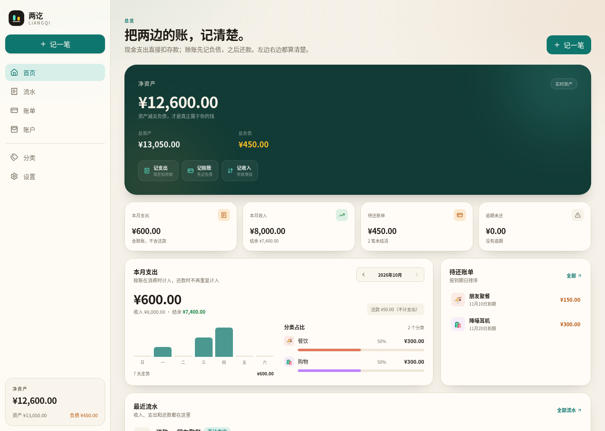
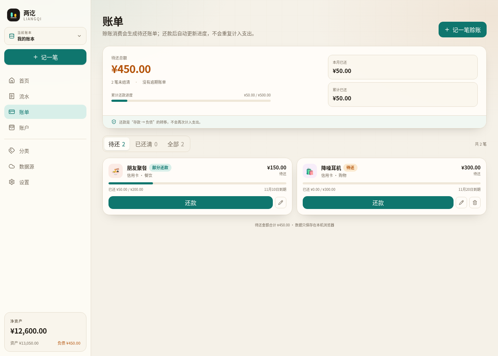
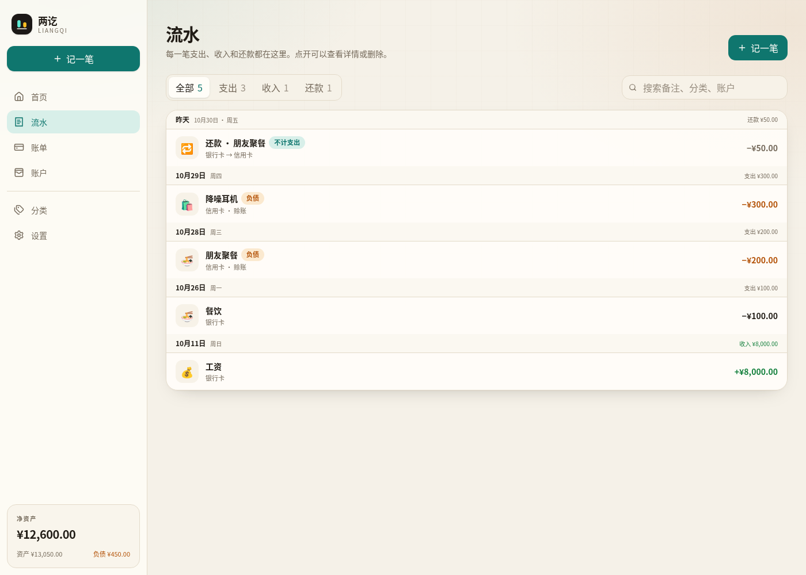
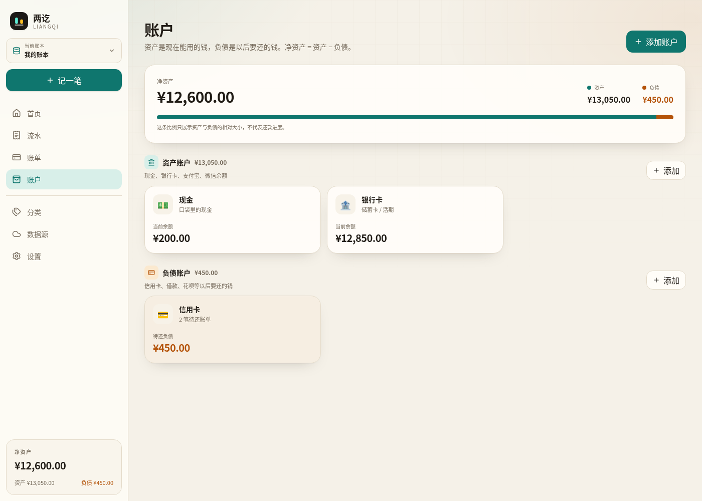
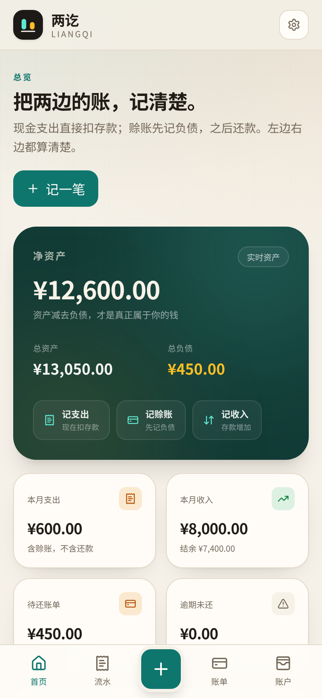
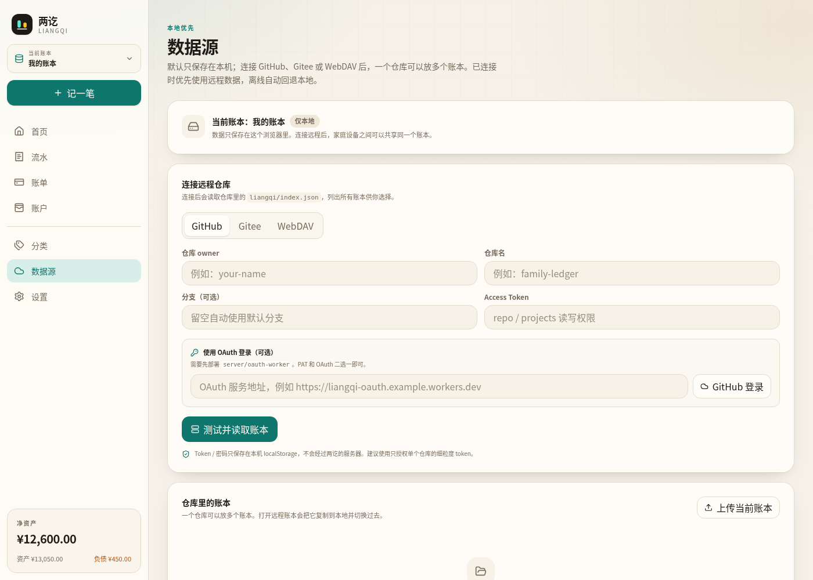

# 两讫 · Liangqi

> 银货两讫，账目两清。

两讫是一个**本地优先、可连接远程仓库**的记账 Web App，专门把两类支出分开：

- **现金支出**：现在就从存款里扣。
- **赊账支出**：现在不动存款，只增加负债，之后还款。

默认情况下数据只保存在本机，可以放多个账本；连接 GitHub、Gitee 或 WebDAV 后，一个仓库可以保存多个账本。连接远程时优先使用远程数据，离线自动回退本地。



## 它解决什么问题

大多数记账 App 只记录「花了多少」，但现实里经常是：

> 这顿饭是刷信用卡的，钱还没从银行卡扣，但支出已经发生了。

两讫把这件事拆成三笔逻辑：

| 操作 | 资产 / 存款 | 负债 | 支出 |
| --- | ---: | ---: | ---: |
| 现金消费 | −100 | 0 | +100 |
| 赊账消费 | 0 | +100 | +100 |
| 还款 | −100 | −100 | 0 |
| 借款到账 | +100 | +100 | 0 |

关键点：

- 赊账消费在**资产**层面只增加负债、不动存款；但在**损益**层面仍要在消费当时确认支出。否则「这个月花了多少」会漏掉。
- 还款是「资产 → 负债」的转移，**不能再记一笔支出**，否则同一笔消费会被统计两次。
- 净资产 = 资产合计 − 负债合计。还款不会改变净资产，只会改变资产和负债的构成。

## 功能

- **多账本**：本地书库可以放家庭账、旅行账、生意账等多个账本，随时切换。
- **资产 / 负债账户**：现金、银行卡、信用卡、花呗、借款等，支持期初余额；资产账户可标记是否计入「可支配资产」。
- **资产概览**：总资产、总负债、可支配、净资产。
- **两种支出方式**：现在扣存款，或先记负债生成待还账单。
- **账单管理**：账单名称、分类、到期日、部分还款、已还清状态。
- **还款**：从资产账户还款，自动减少负债和存款，不重复计入支出。
- **账户转账**：现金、银行卡等资产账户之间互转，只改变余额，不计入收支和预算。
- **成员归属**：每个账单和流水可以归属到家庭成员，账单卡片和流水里都会显示成员。
- **标签与标签组**：跨分类标记流水和账单，例如「旅行」「出差」「装修」；标签组支持单选或多选。
- **两级分类**：支出 / 收入分类都可以设置父分类，例如「餐饮 / 午餐」，统计和预算会包含子分类。
- **预算**：按月度或年度设置分类、标签、成员预算，首页显示进度，超支提醒。
- **周期记账**：房租、工资、订阅等按天 / 周 / 月 / 年自动生成流水，支持暂停和立即补记。
- **CSV 导入**：微信、支付宝、银行 CSV，自动识别列、预览并导入；支持按分类名称匹配。
- **多币种记账**：记账时可选外币，自动获取实时汇率，也可以手动修改；按本位币保存余额和统计，同时保留原始金额。
- **附件**：流水和账单可以添加小票、发票、截图；文件保存在本机 IndexedDB，并可在同步时上传到远程仓库，其他设备打开时按需下载。
- **智能记账**：输入或说一句「昨天午饭 35 现金」，自动识别金额、分类、账户、日期；语音使用浏览器 Web Speech。可以在设置里连接 OpenAI 兼容接口，用 AI 解析更复杂的一句话。
- **AI 助手**：连接到 OpenAI 兼容接口后，可以基于当前账本的本月收支、12 个月趋势、分类、标签、成员、预算和待还账单进行对话分析、预算建议和年度总结。
- **位置与地图**：流水可以记录当前位置，并在「分析 → 消费足迹」用 OpenStreetMap 查看地点分布。
- **批量修改**：在流水页进入批量模式，多选后统一修改分类、成员或标签，适合整理导入的账单。
- **本地密码**：可设置本地密码锁，PBKDF2 哈希保存在本机，打开应用时需要解锁。
- **统计**：净资产、本月支出、本月收入、待还总额、逾期金额、分类占比、7 天走势、预算进度；独立「分析」页提供 6 个月趋势、标签 / 成员分布、大额支出、多维筛选和可保存的自定义分析视图。
- **分类管理**：支出 / 收入分类，支持自定义名称、Emoji、颜色和父分类。
- **PWA**：可安装到桌面 / 手机主屏幕，Service Worker 缓存应用外壳，离线可打开。
- **远程数据源**：GitHub、Gitee、WebDAV；**一个仓库对应一本共享账**，不同用户连接同一个仓库就会进入同一本账。
- **多用户与作者权限**：多个人可以共用同一个 GitHub / Gitee 私钥（Token）连接同一个仓库；连接后各自选择自己的成员登录，流水和账单记录该成员为作者，其他人只能查看，不能修改或删除他人的记账。成员可以设置可选 PIN，切换成员时验证。成员列表会同步到仓库。
- **增量合并**：同步时按流水 / 账单 id 合并双方新增内容，同一记录以最新更新时间较新的版本为准；删除使用墓碑记录，避免多人同步时把对方新增的账覆盖掉。
- **本地优先 + 远程优先读取**：本地立即写入；连接远程后打开账本优先拉远程，离线自动用本地。
- **增量同步**：先读 manifest 判断远程是否有变化，没有变化时跳过 meta 和全部分片；拉取时按分片哈希复用本机缓存，上传只写哈希变化的分片。
- **冲突备份**：远程覆盖本地时，被覆盖版本保存在本机，可下载 JSON。
- **备份**：单账本 JSON、整个书库 JSON；GitHub / Gitee 仓库本身保留提交历史。
- **深色模式**：浅色、深色、跟随系统。
- **响应式**：桌面端侧边栏，手机端底部导航和底部弹层。

| 账单 | 流水 |
| --- | --- |
|  |  |

| 账户 | 手机端 |
| --- | --- |
|  |  |

| 数据源 | |
| --- | --- |
|  | 本地 / GitHub / Gitee / WebDAV 四种模式 |

## 远程仓库结构

一个仓库只保存一本共享账：

```text
repo/
└── liangqi/
    ├── meta.json          # 账户、分类、标签、预算、周期规则、成员、设置、账本信息、删除墓碑
    ├── manifest.json      # 分片清单、哈希、条数
    ├── entries-0.json     # 第 0–999 条流水
    ├── entries-1000.json  # 第 1000–1999 条流水
    ├── bills-0.json       # 账单分片
    └── attachments/       # 附件文件（base64 JSON，按需下载）
```

每个分片默认 1000 条。`manifest.json` 记录每个分片的起始位置、条数和内容哈希。

旧版多账本布局（`liangqi/index.json` + `liangqi/books/<bookId>/`）仍然可以读取；第一次同步后会写入新的单账本根布局。旧版单文件 `books/<bookId>.json` 也保留读取兼容。旧版仓库如果包含多本账，只迁移当前绑定的那一本，其他账本仍留在仓库里但不会出现在新的共享账列表中。

多个人可以共用同一个私钥连接同一个仓库。连接后，每个用户在「当前记账成员」里选择自己登录的成员；新流水和账单会把该成员写成作者。成员列表保存在账本的 `meta.json` 中，会随远程同步，所有设备可见。没有选择成员时，共享账保持只读，新增记账会被阻止。

## 同步规则

- **本地立即写**：每次修改先写浏览器 IndexedDB，界面立刻更新；localStorage 作为兜底镜像。
- **增量拉取**：先读 `manifest.json` 判断远程是否有变化，没有变化时跳过 meta 和全部分片；拉取时按分片哈希复用本机缓存。
- **自动推送**：本地修改后延迟约 1.8 秒推送到远程；失败不阻塞记账。
- **分片上传**：只上传内容哈希发生变化的分片；GitHub 通过 Git Data API 把多个分片合并成一次 commit，Gitee / WebDAV 按文件写入。
- **逐条合并**：同步时把远程和本地的流水、账单按 id 合并，双方新增都会保留；同一 id 取 `updatedAt` 较新的版本。
- **删除墓碑**：删除流水 / 账单时写入 `deletedEntries` / `deletedBills` 墓碑，删除账户 / 分类 / 标签 / 成员 / 预算 / 周期规则 / 附件时写入 `deletedConfig`，其他设备同步后一起删除，不会因为对方还持有旧副本而复活。
- **作者保护**：流水、账单、周期规则和附件记录作者 id。非作者只能查看，不能修改或删除；还款、新增流水不受影响。
- **共享配置**：账户、分类、标签、成员、预算、周期规则、附件等是账本级共享配置，按 id 合并，重复 id 以远程版本为准，并应用共享配置墓碑。
- **冲突备份**：实际写入前如果发现本地和远程都有修改，会先保存一份本地版本到「数据源 → 冲突备份」，最多 10 份。
- **离线回退**：远程不可用时继续使用本地，恢复后自动合并并补推。

## 部署形态

- **纯静态前端**：`pnpm build` 产出 `dist/`，可部署到 Cloudflare Pages、GitHub Pages、Netlify 等；没有数据库、没有 API 服务。
- **完全无后端**：使用 GitHub / Gitee PAT 或 WebDAV；不启用 OAuth。
- **可选 OAuth**：只有 OAuth 需要 `server/oauth-worker` 做 code exchange，它不保存账本数据；不想部署就只用 PAT。
- **WebDAV 注意**：浏览器直连要求服务器允许 CORS；不支持 CORS 的 WebDAV 需要额外代理，那种情况下才需要后端。

### 部署到子路径

```bash
# 生成 /workbook/ 前缀的静态文件
pnpm build:workbook
```

Nginx 示例：

```nginx
location = /workbook { return 301 /workbook/; }
location /workbook/ {
    root /var/www;
    try_files $uri $uri/ /workbook/index.html;
    index index.html;
}
```

也可以使用 `scripts/deploy-workbook.sh`，通过 `DEPLOY_HOST` / `DEPLOY_USER` / `DEPLOY_PATH` 部署并在远端 reload nginx。SSH 需要预先配置好密钥或 ssh-agent。

## 登录方式

### PAT Token

- GitHub：创建有 `repo` 权限的 token。
- Gitee：创建有 `projects` 权限的 token。
- Token 只保存在本机 `localStorage`，不会经过两讫的服务器。建议使用只授权单个仓库的细粒度 token。

### OAuth（可选）

`server/oauth-worker` 是一个 Cloudflare Worker 参考实现，负责 GitHub / Gitee 的 OAuth code exchange：

- 应用打开弹窗 → Worker 跳转 GitHub / Gitee 授权 → 回调交换 token → `postMessage` 返回应用。
- 部署和配置见 [server/oauth-worker/README.md](server/oauth-worker/README.md)。
- 在「数据源 → OAuth 服务地址」填入 Worker 地址即可使用。

### WebDAV

支持 Nextcloud、Alist、群晖等标准 WebDAV。填写地址、用户名、密码即可。WebDAV 服务器需要允许浏览器跨域访问（CORS），否则连接会失败。

## 快速开始

要求 Node.js 22+ 和 pnpm。

```bash
pnpm install
pnpm dev
```

打开终端输出的地址（默认 `http://localhost:5173`）。

其他命令：

```bash
pnpm test       # 账务、备份、远程适配器测试
pnpm typecheck  # TypeScript 类型检查
pnpm lint       # oxlint
pnpm build      # 生产构建
pnpm preview    # 预览构建结果
```

## 使用方式

1. 打开首页，点击左上角「当前账本」可以新建 / 切换账本。
2. 到「账户」页设置资产账户的期初余额（例如银行卡里现在有多少钱）。
3. 记一笔支出时选择：
   - **现在扣存款**：从现金 / 银行卡支出。
   - **先记负债**：记到信用卡 / 花呗，生成待还账单。
4. 到「账单」页查看待还金额和到期日，点「还款」从存款账户还款。
5. 到「数据源」页连接 GitHub / Gitee / WebDAV，选择一个远程账本，或把当前账本上传到仓库。
6. 在「设置 → 数据管理」导出单账本或整个书库备份。

### 标签、分类与预算

- 到「分类」页可以给支出 / 收入分类设置父分类，例如「餐饮 / 午餐」；选择父分类做预算时会自动包含子分类。
- 到「标签」页创建标签组和标签，记账、编辑账单、设置预算时都可以选择。
- 到「预算」页按月度或年度设置金额，并圈定分类、标签或成员；首页会显示进度和超支提醒。

### 分析

「分析」页可以按月查看收入、支出、结余和储蓄率，以及近 6 个月趋势、合并二级分类后的分类占比、标签支出、成员支出和大额支出。可以按分类、标签、账户、成员和关键词组合筛选，并把筛选保存成本机的分析视图。统计只包含支出和收入，转账和还款不会重复计入。页面底部还有「消费足迹」，按地点汇总带位置的支出，并嵌入 OpenStreetMap 地图。

### 批量修改

在「流水」页点「批量」，勾选多笔流水后可以统一修改分类、成员或标签。分类要求所选流水的类型一致；转账和还款不能修改分类。这个功能适合 CSV 导入后集中整理分类。

### 周期记账

到「周期」页添加规则，选择支出 / 收入、账户、分类和频率（天 / 周 / 月 / 年）。启用的规则会在打开应用或同步后自动补记到期流水；也可以点「立即入账」手动补记。暂停后不会继续生成，删除规则会保留已经生成的流水。

### CSV 导入

到「导入」页选择微信、支付宝或银行导出的 CSV。应用会自动寻找表头并猜测「交易时间 / 金额 / 收 / 支 / 分类 / 备注」列；确认预览后再导入。分类按名称匹配，匹配不到时使用你选择的默认分类；「不计收支 / 转账 / 还款」会跳过。

### 多币种与附件

记账时可以切换币种，应用会先读取本机缓存，再向公开汇率源请求最新汇率；保存时会按当时的实时汇率换算成本位币。汇率源不可用或你手动改过汇率时，会使用当前显示的手动汇率。流水会同时保留外币原始金额和换算后的本位币金额，余额和统计统一使用本位币。流水和账单可以添加附件；附件文件保存在本机 IndexedDB，同步时会上传到仓库的 `attachments/` 目录，其他设备打开时按需下载。

### 智能记账与位置

首页、侧边栏或手机顶部的麦克风按钮可以打开「一句话记账」，输入或说「昨天午饭 35 现金」。应用会在本机解析金额、分类、账户和日期，再打开表单让你确认。到「设置 → AI 助手」填写 OpenAI 兼容的 `/chat/completions` 地址、模型和 API Key 后，还可以点「AI 识别」处理更复杂的表达。记账表单里可以获取当前位置，位置会出现在「分析 → 消费足迹」。

### AI 助手

配置好 AI 接口后，从侧边栏或「设置 → AI 助手」打开 AI 助手页。它会读取当前账本的聚合快照（资产、本月 / 上月 / 今年收支、近 12 个月趋势、分类、标签、成员、预算、待还账单和最近 25 条流水摘要），可以回答「这个月花在哪」「给我下个月预算建议」「总结今年」等问题。对话按账本保存在本机，可以随时清空。附件文件、精确位置、token 和密码不会发送给 AI。

### 安装为 PWA

使用 HTTPS 打开应用后，浏览器会提示安装到桌面或主屏幕；也可以在浏览器菜单中选择「安装应用 / 添加到主屏幕」。安装后可以离线打开应用外壳，账本数据仍然保存在本机。iOS / Android 安装步骤和可选的 Capacitor 原生壳见 [docs/mobile.md](docs/mobile.md)。

### 本地密码

到「设置 → 本地密码」设置至少 6 位密码。密码使用 PBKDF2-SHA256 哈希后保存在本机，打开应用或刷新新标签页时需要解锁；同一标签页刷新会保持解锁。

注意：**本地密码只保护界面访问，不加密 IndexedDB / localStorage 里的账本数据**。能打开浏览器开发者工具的人仍然可以读到本地数据；如果忘记密码，只能清除浏览器数据。

### 成员

到「成员」页添加家庭成员。记账时在金额下方选择成员；赊账生成的账单会继承该成员，账单和流水列表都会显示成员标签。成员只影响归属和展示，不影响金额、余额和统计。

### 可支配资产

首页资产卡显示四个数字：

- **总资产**：所有资产账户余额之和。
- **总负债**：所有负债账户余额之和。
- **可支配**：流动资产 − 总负债。现金、银行卡等默认计入流动资产；房产、投资等可以在账户编辑里关闭「计入可支配资产」。
- **净资产**：总资产 − 总负债。

当所有资产都是流动资产时，可支配和净资产相同；存在房产、投资等非流动资产时会分开显示。

期初余额只在创建账户时填写，之后不能修改；如果需要调整，请通过新增流水或还款处理。这是为了避免历史账目被悄悄改掉。

## 数据与隐私

- 本地书库优先保存在浏览器 **IndexedDB**（`keyval-store` / `liangqi-library-v2`），同时保留 `localStorage` 镜像作为兜底。
- 旧版单账本 `liangqi-ledger-v1` / `zhaibu-ledger-v1` 会在首次启动时迁移到书库，旧键保留，方便回滚。
- 旧的 `zhaibu` 单账本备份仍可导入；新导出使用 `liangqi` 标识。
- 远程模式下，账本数据保存在你自己的 GitHub / Gitee 仓库或 WebDAV 服务器；两讫没有自己的数据服务器。
- 多用户共享账本时，流水 / 账单会记录公开的记账人 id 和显示名；token、密码不会写入远程账本。
- 当前每本账登录的成员保存在本机 `localStorage`（`liangqi-active-members-v1`），不会同步到远程；成员名称、颜色等资料保存在账本 `meta.json` 中。
- 成员 PIN 只保存 PBKDF2 哈希、盐和迭代次数，不保存明文；切换成员时在本地验证。没有设置 PIN 的成员仍然可以直接选择。
- 作者权限在应用内校验：其他协作者在界面上只能查看你的记账，不能修改或删除。拥有仓库写权限的人仍然可以通过 Git 工具直接改文件，因此这里的权限是应用层而不是服务端强制。
- OAuth Worker 只做 code exchange，不存储账本数据。
- **Token / 密码保存在本机 `localStorage`**，以便刷新后保持连接；请使用细粒度、单仓库权限的 token。
- **AI API Key 保存在本机 `localStorage`（`liangqi-ai-v1`）**，AI 请求由浏览器直接发往你配置的接口，不经过两讫服务器；不使用 AI 时不会发起任何外部请求。地图使用 OpenStreetMap 嵌入页面，加载时会访问 openstreetmap.org。
- AI 对话记录按账本保存在本机 `localStorage`（`liangqi-ai-chat-v1:<bookId>`），不会同步到远程；可以在 AI 助手页清空。每次 AI 请求会发送账本聚合摘要和最近 25 条流水摘要，不发送附件文件、精确位置、token 或密码。
- 切换外币时，浏览器会向你网络可达的公开汇率源请求汇率（默认依次尝试 currency-api / open.er-api.com），请求只包含币种代码，不包含账本内容；汇率缓存保存在本机 `liangqi-fx-rates-v1`。
- **清除浏览器数据会丢失本地书库**。请定期导出备份；已连接远程的数据可以从远程重新拉取。
- 本地密码哈希保存在 `liangqi-auth-v1`；解锁状态只保存在当前标签页的 `sessionStorage`。
- 本地密码不加密账本数据，不能替代磁盘加密或浏览器账户保护。
- 书库备份默认**不包含 token / 密码**，导入后需要重新填写远程凭据。
- 冲突备份保存在 `liangqi-conflicts-v1`，可在数据源页下载或清空。
- 远程分片缓存保存在 IndexedDB `liangqi-remote-chunks`，按内容哈希复用未变化的分片，避免重复下载。
- 附件文件保存在 IndexedDB 的 `liangqi-attachments`，同步后还会上传到远程仓库的 `liangqi/attachments/`；超过 5 MB 的附件只保留在本机。其他设备打开时会按需从远程下载。
- PWA Service Worker 只缓存应用外壳和静态资源，不会缓存或上传账本数据。

## 技术栈

- React 19 + TypeScript
- Vite 8
- Tailwind CSS 4
- Zustand（书库 + 当前账本状态）
- IndexedDB（`idb-keyval`，本地主存储）
- React Router 7（HashRouter，静态托管无需服务端重写）
- Web Speech API（浏览器语音识别，可选）
- OpenAI 兼容接口（可选 AI 解析）
- OpenStreetMap 嵌入地图（可选）
- Vitest（账务、备份、远程适配器测试）
- Lucide React（界面图标，ISC 许可）
- Cloudflare Worker（可选 OAuth 服务，`server/oauth-worker`）

金额全部以**整数分**存储，计算过程中不使用浮点数，避免 `0.1 + 0.2` 类问题。

## 项目结构

```text
src/
├── domain/
│   ├── ledger.ts      # 账户余额、账单状态、统计等纯函数
│   ├── budgets.ts     # 预算范围与进度
│   ├── recurring.ts   # 周期日期推进与到期计算
│   ├── csv.ts         # CSV 解析、列识别和交易标准化
│   ├── quick-entry.ts # 一句话记账的自然语言解析
│   ├── ai.ts          # OpenAI 兼容请求与 AI 快速记账
│   ├── ai-context.ts  # 给 AI 的账本聚合快照
│   ├── exchange-rates.ts # 实时汇率、缓存与手动兜底
│   ├── filters.ts     # 多维流水筛选
│   ├── member-pin.ts  # 成员 PIN 哈希与验证
│   ├── merge.ts       # 多人账本的逐条合并、墓碑和作者认领
│   ├── member-session.ts # 当前登录成员与每本书的本地身份
│   ├── analysis-views.ts # 本机保存的自定义分析视图
│   ├── attachments.ts # 附件元数据与 IndexedDB 文件存储
│   ├── money.ts       # 金额解析与格式化
│   ├── backup.ts      # 单账本 / 书库备份与校验
│   └── seed.ts        # 默认账户、分类和账本
├── remote/
│   ├── chunks.ts       # 分片、哈希、manifest
│   ├── chunk-cache.ts  # 按哈希缓存远程分片
│   ├── attachments.ts  # 附件 base64 远程上传 / 下载
│   ├── git-contents.ts # GitHub / Gitee；GitHub 使用 Git Data API 批量提交
│   ├── webdav.ts       # WebDAV GET / PUT / MKCOL
│   ├── repository.ts   # 单账本 meta.json + manifest + 分片
│   ├── sync.ts         # 拉取、合并、推送、冲突处理
│   └── oauth.ts        # OAuth 弹窗
├── store/
│   ├── library.ts      # 书库、账本列表、连接配置
│   ├── ledger.ts       # 当前账本 + 账务 / 成员 actions
│   ├── auth.ts         # 本地密码
│   ├── book-actions.ts # 切换 / 新建 / 删除账本
│   └── ui.ts           # 全局弹层状态
├── pages/              # 首页、流水、账单、账户、分类、标签、预算、分析、AI 助手、周期、导入、成员、数据源、设置
├── components/         # 布局、账本切换、弹层、卡片、图表等
├── hooks/
├── utils/
└── types.ts            # 数据模型

server/
└── oauth-worker/       # 可选 GitHub / Gitee OAuth Worker
```

核心数据模型在 `src/types.ts`：

- `Library`：多个 `Book` + 当前账本 + 远程连接配置。
- `Book`：账户、分类、标签组、标签、预算、周期规则、附件、删除墓碑、成员、账单、流水、币种、远程绑定。
- `Account`：`asset` 或 `liability`，带期初余额；资产可标记 `liquid` 是否计入可支配资产。
- `Member`：账单和流水的归属成员，也是共享账里的登录身份和记账作者。
- `Category`：支出 / 收入分类，可通过 `parent` 组成两级分类。
- `TagGroup` / `Tag`：标签组定义单选或多选，标签可跨分类标记流水和账单。
- `Budget`：月度 / 年度预算，可按分类（含子分类）、标签、成员筛选支出。
- `RecurringRule`：周期记账规则，保存频率、下次日期、账户和分类。
- `Attachment`：附件元数据；文件二进制保存在本机 IndexedDB。
- `Bill`：一张待还账单，记录本金、到期日、成员、标签、附件、作者；还款金额由流水推导。
- `Entry`：`expense` / `income` / `repayment` / `transfer`，支出和还款通过 `billId` 关联账单，转账通过 `toAccountId` 关联转入账户，可关联成员、标签、附件、位置、外币原始金额和作者。
- `Tombstone`：删除墓碑，记录被删除流水 / 账单 id、时间和作者，用于多端合并。

余额、账单剩余金额和统计结果都是**推导值**，不单独存一份余额，避免数据不同步。

## 路线图

- [ ] S3 兼容存储
- [ ] SQLite 备份快照
- [ ] 操作日志 / 字段级 CRDT
- [ ] 分期还款计划
- [ ] 真实 GitHub / Gitee / WebDAV 双用户联调
- [ ] 更多统计视图和年度报告
- [ ] 原生 iOS / Android 壳（可用 Capacitor 包装 PWA）
- [ ] 更完整的组件测试与端到端测试

## 许可证

本项目以 **GNU General Public License v3.0 or later（GPL-3.0-or-later）** 发布，完整文本见 [LICENSE](LICENSE)。

### 与 Cent 的关系

两讫是**独立实现**，不是 Cent 的 fork，不包含 Cent 的源代码、文案或素材。功能思路受开源项目 [Cent](https://github.com/glink25/Cent) 启发；Cent 版权归 glink25 所有，采用 CC BY-NC-SA 4.0。

Cent 的许可证**不适用于本项目**；本项目的原创代码按 GPL-3.0-or-later 发布。如果你打算把 Cent 的代码合并进来，需要注意 CC BY-NC-SA 4.0 与 GPLv3 不兼容（NonCommercial 与 ShareAlike 条款冲突），必须先取得 Cent 作者授权。

### 品牌与素材

「两讫 / LIANGQI」名称和双栏 Logo 为本项目原创。界面图标使用 Lucide（ISC 许可）和系统 Emoji，不包含 Cent 的图标、文案或截图素材。

名称与 Logo 尚未做正式的商标注册检索；如果计划商业发行，请在目标国家 / 类目自行做商标查询。本项目不声称拥有任何注册商标。

第三方依赖与图标的许可证见 [THIRD_PARTY_NOTICES.md](THIRD_PARTY_NOTICES.md)。

## 免责声明

本项目是记账工具，不构成财务、税务或投资建议。使用前请先导出备份；作者不对因数据丢失、计算错误或使用本软件造成的损失负责。
