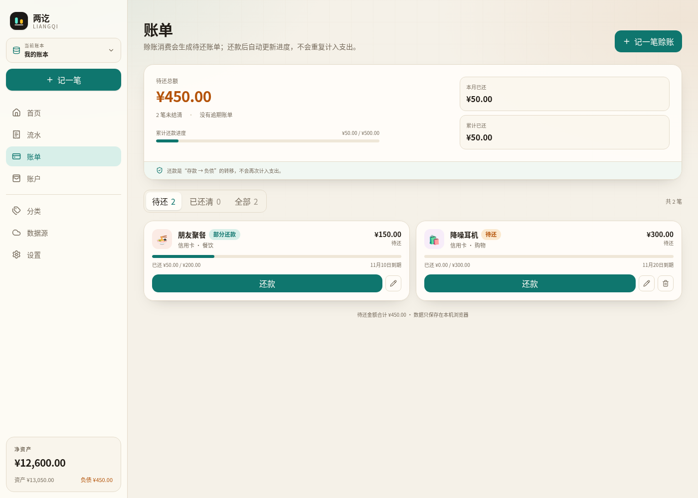
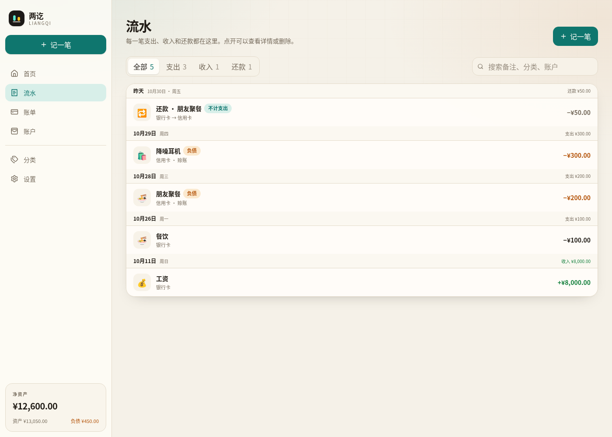
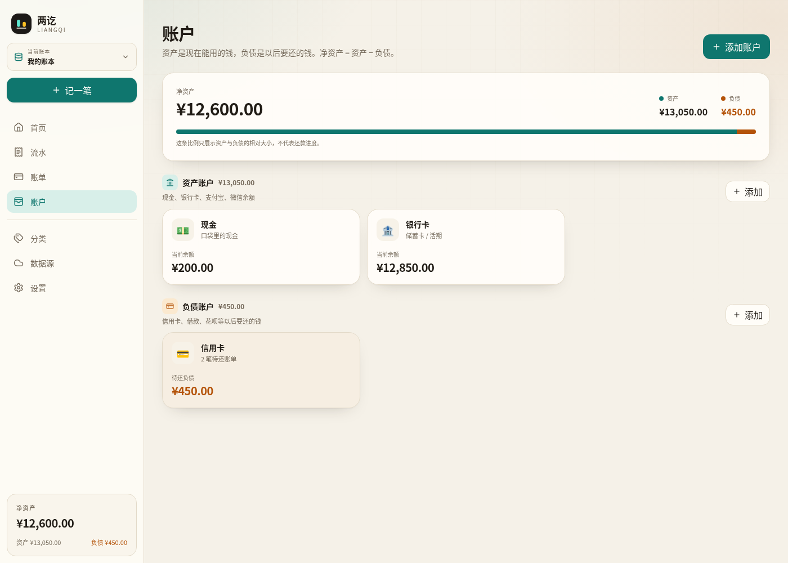
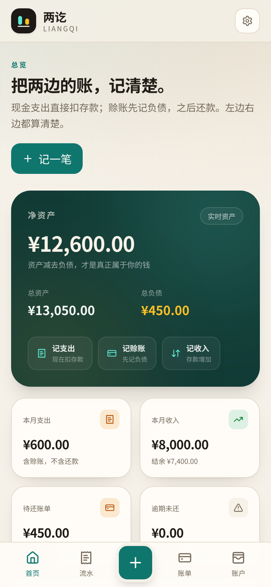
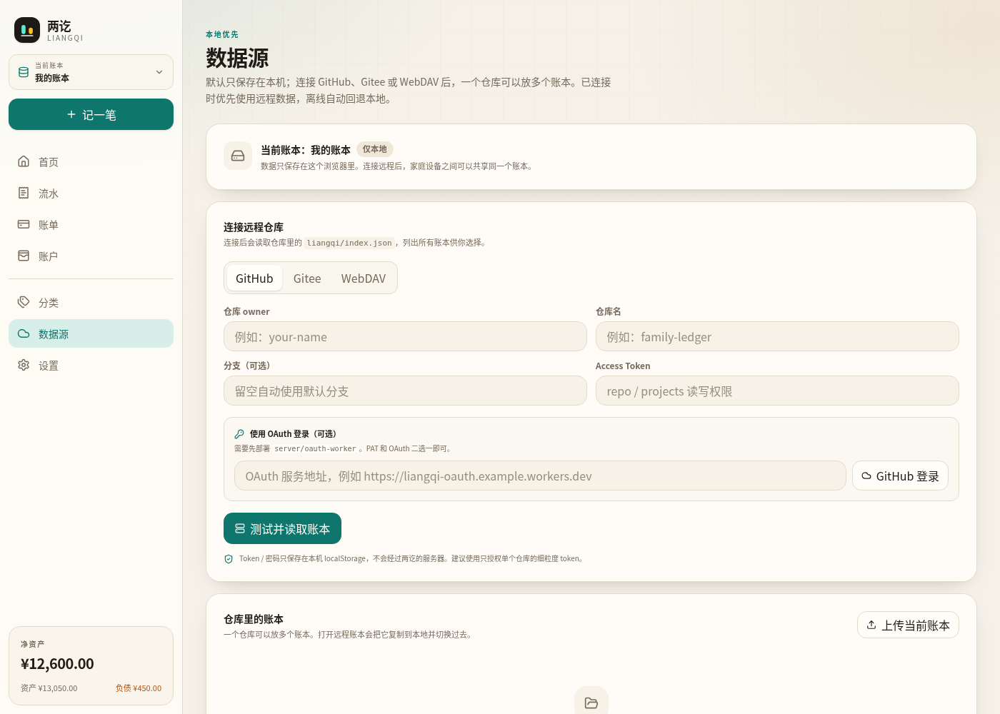

# 兩訖 · Liangqi

> 銀貨兩訖，帳目兩清。

**語言：** [簡體中文](README.md) · **繁體中文** · [English](README.en.md) · [日本語](README.ja.md) · [한국어](README.ko.md) · [Español](README.es.md) · [Français](README.fr.md) · [Deutsch](README.de.md) · [Português](README.pt.md) · [Русский](README.ru.md)

**線上使用：** https://arksc.cn:8002/workbook/  
**原始碼儲存庫：** [Gitee](https://gitee.com/PharaohMan/liangqi-app) · [GitHub](https://github.com/yejunhui/liangqi-app)  
**開源協議：** AGPL-3.0-or-later · **AI／開發脈絡：** [AGENTS.md](AGENTS.md)

兩訖是一個**本機優先、可連線遠端儲存庫**的記帳 Web App，專門把兩類支出分開：

- **現金支出**：現在就從存款里扣。
- **賒帳支出**：現在不動存款，只增加負債，之後還款。

預設情況下資料只儲存在本機，可以放多個帳本；連線 GitHub、Gitee 或 WebDAV 後，一個儲存庫儲存一本共享帳，多個成員共用同一個儲存庫。連線遠端時優先使用遠端資料，離線自動回退本機。


## 它解決什麼問題

大多數記帳 App 只記錄「花了多少」，但現實裡經常是：

> 這頓飯是刷信用卡的，錢還沒從銀行卡扣，但支出已經發生了。

兩訖把這件事拆成三筆邏輯：

| 操作 | 資產 / 存款 | 負債 | 支出 |
| --- | ---: | ---: | ---: |
| 現金消費 | −100 | 0 | +100 |
| 賒帳消費 | 0 | +100 | 0 |
| 還款 | −100 | −100 | +100 |
| 借款到帳 | +100 | +100 | 0 |

關鍵點：

- 賒帳消費只增加負債、不動存款，**消費當時不計支出**；還款時再按還款金額計入支出。
- 還款是「資產 → 負債」的轉移，同時確認還款當期的支出。
- 淨資產 = 資產合計 − 負債合計。賒帳消費會增加負債，所以淨資產在消費時已經下降；還款不會改變淨資產。

## 功能

- **多帳本**：本機書庫可以放家庭帳、旅行帳、生意帳等多個帳本，隨時切換。
- **資產 / 負債帳戶**：現金、銀行卡、信用卡、花唄、借款等，支援期初餘額；資產帳戶可標記是否計入「可支配資產」。
- **資產概覽**：總資產、總負債、可支配、淨資產。
- **兩種支出方式**：現在扣存款，或先記負債生成待還帳單。
- **帳單管理**：帳單名稱、分類、到期日、部分還款、已還清狀態。
- **還款**：從資產帳戶還款，自動減少負債和存款，並在還款時計入支出。
- **帳戶轉帳**：現金、銀行卡等資產帳戶之間互轉，只改變餘額，不計入收支和預算。
- **成員歸屬**：每個帳單和流水可以歸屬到家庭成員，帳單卡片和流水裡都會顯示成員。
- **標籤與標籤組**：內建「生活場景 / 費用用途 / 關聯物件」日常標籤，跨分類標記流水和帳單；標籤組支援單選或多選，也可以隨時新增自己的標籤。
- **兩級分類**：支出 / 收入分類都可以設定父分類，例如「餐飲 / 午餐」，統計和預算會包含子分類。
- **預算**：按月度或年度設定分類、標籤、成員預算，首頁顯示進度，超支提醒；支援根據最近 3 個月支出生成智慧預算建議。
- **週期記帳**：房租、工資、訂閱等按天 / 周 / 月 / 年自動生成流水，支援暫停和立即補記。
- **CSV 匯入**：微信、支付寶、銀行 CSV，自動識別列、預覽並匯入；支援按分類名稱匹配。
- **多幣種記帳**：記帳時可選外幣，自動獲取實時匯率，也可以手動修改；按本位幣儲存餘額和統計，同時保留原始金額。
- **附件**：流水和帳單可以新增小票、發票、截圖；檔案儲存在本機 IndexedDB，並可在同步時上傳到遠端儲存庫，其他裝置開啟時按需下載，最大 10 MB。
- **智慧記帳**：輸入或說一句「昨天午飯 35 現金」，自動識別金額、分類、帳戶、日期；語音使用瀏覽器 Web Speech。可以在設定裡連線 OpenAI 相容介面，用 AI 解析更複雜的一句話。
- **AI 助手**：連線到 OpenAI 相容介面後，可以基於當前帳本的本月收支、12 個月趨勢、分類、標籤、成員、預算和待還帳單進行對話分析、預算建議和年度總結。
- **位置與地圖**：流水可以記錄當前位置，並在「分析 → 消費足跡」用 OpenStreetMap 檢視地點分佈。
- **批次修改**：在流水頁進入批次模式，多選後統一修改分類、成員或標籤，適合整理匯入的帳單。
- **本機密碼**：可設定本機密碼鎖，PBKDF2 雜湊儲存在本機，開啟應用時需要解鎖。
- **統計**：淨資產、本月支出、本月收入、待還總額、逾期金額、分類佔比、7 天走勢、預算進度；獨立「分析」頁提供 6 個月趨勢、標籤 / 成員分佈、大額支出、多維篩選和可儲存的自定義分析檢視。
- **報表匯出**：分析頁可以匯出當前篩選結果的 CSV（Excel 可直接開啟），也可以生成並列印 PDF 月報。
- **分類管理**：支出 / 收入分類，支援自定義名稱、Emoji、顏色和父分類。
- **PWA**：可安裝到桌面 / 手機主螢幕，Service Worker 快取應用外殼，離線可開啟。
- **遠端資料來源**：GitHub、Gitee、WebDAV；**一個儲存庫對應一本共享帳**，不同使用者連線同一個儲存庫就會進入同一本帳。
- **多使用者與作者許可權**：多個人可以共用同一個 GitHub / Gitee 私鑰（Token）連線同一個儲存庫；連線後在登入頁選擇成員並輸入密碼。共享帳本強制成員密碼，成員密碼的 PBKDF2 雜湊會隨成員資訊寫入儲存庫 `meta.json`。登入後必須透過「切換使用者 / 鎖定」退出，再回到成員列表重新登入；流水和帳單記錄該成員為作者，其他人只能檢視，不能修改或刪除他人的記帳。成員列表會同步到儲存庫。
- **增量合併**：同步時按流水 / 帳單 id 合併雙方新增內容，同一記錄按欄位更新時間做欄位級合併；刪除使用墓碑記錄，避免多人同步時把對方新增的帳覆蓋掉。
- **快捷指令 / 個性化**：支援 `#/quick?text=...` URL 快速記帳、剪貼簿貼上、自定義 CSS、N 記一筆 / Q 一句話記帳快捷鍵。
- **本機優先 + 遠端優先讀取**：本機立即寫入；連線遠端後開啟帳本優先拉遠端，離線自動用本機。首頁右上角的雲圖示顯示當前同步狀態：本機帳本、待同步、同步中、已同步、離線或同步失敗；點選可進入資料來源頁檢視詳情。
- **增量同步**：先讀 manifest 判斷遠端是否有變化，沒有變化時跳過 meta 和全部分片；拉取時按分片雜湊複用本機快取，上傳只寫雜湊變化的分片。
- **衝突備份**：遠端覆蓋本機時，被覆蓋版本儲存在本機，可下載 JSON。
- **備份**：單帳本 JSON、整個書庫 JSON；GitHub / Gitee 儲存庫本身保留提交歷史。
- **多語言**：介面支援簡體中文、繁體中文、English、日本語、한국어、Español、Français、Deutsch、Português、Русский；首次開啟按瀏覽器語言選擇，也可以在「設定 → 介面語言」切換。語言只儲存在本機，不寫入共享帳本；金額、日期和報表會跟隨語言格式化。
- **深色模式**：淺色、深色、跟隨系統。
- **響應式**：桌面端側邊欄，手機端底部導航和底部彈層。

| 帳單 | 流水 |
| --- | --- |
|  |  |

| 帳戶 | 手機端 |
| --- | --- |
|  |  |

| 資料來源 | |
| --- | --- |
|  | 本機 / GitHub / Gitee / WebDAV 四種模式 |

## 遠端儲存庫結構

一個儲存庫只儲存一本共享帳：

```text
repo/
└── liangqi/
    ├── meta.json          # 帳戶、分類、標籤、預算、週期規則、成員、設定、帳本資訊、刪除墓碑
    ├── manifest.json      # 分片清單、雜湊、條數
    ├── entries-0.json     # 第 0–999 條流水
    ├── entries-1000.json  # 第 1000–1999 條流水
    ├── bills-0.json       # 帳單分片
    └── attachments/       # 附件檔案（base64 JSON，按需下載）
```

每個分片預設 1000 條。`manifest.json` 記錄每個分片的起始位置、條數和內容雜湊。

舊版多帳本佈局（`liangqi/index.json` + `liangqi/books/<bookId>/`）仍然可以讀取；第一次同步後會寫入新的單帳本根佈局。舊版單檔案 `books/<bookId>.json` 也保留讀取相容。舊版儲存庫如果包含多本帳，只遷移當前繫結的那一本，其他帳本仍留在儲存庫裡但不會出現在新的共享帳列表中。

多個人可以共用同一個私鑰連線同一個儲存庫。連線後，每個使用者在登入頁選擇自己的成員並輸入密碼；新流水和帳單會把該成員寫成作者。成員列表和成員密碼雜湊儲存在帳本的 `meta.json` 中，會隨遠端同步，所有裝置可見。共享帳本的成員必須有密碼。登入後不能直接點選其他成員；必須點「當前記帳成員 → 切換使用者 / 鎖定」，退出到登入頁。鎖定和切換使用者都會回到成員列表；上次登入的成員排在第一位，也可以選擇其他成員，再輸入密碼登入。新建流水、帳單和週期記帳時，成員歸屬預設使用當前登入成員。

## 同步規則

- **本機立即寫**：每次修改先寫瀏覽器 IndexedDB，介面立刻更新；localStorage 作為兜底映象。
- **增量拉取**：先讀 `manifest.json` 判斷遠端是否有變化，沒有變化時跳過 meta 和全部分片；拉取時按分片雜湊複用本機快取。
- **自動推送**：本機修改後延遲約 1.8 秒推送到遠端；失敗不阻塞記帳。
- **分片上傳**：只上傳內容雜湊發生變化的分片；GitHub 透過 Git Data API 把多個分片合併成一次 commit，Gitee / WebDAV 按檔案寫入。
- **逐條合併**：同步時把遠端和本機的流水、帳單按 id 合併，雙方新增都會保留；同一 id 的標題、備註、分類、成員、標籤、附件等欄位按 `fieldUpdatedAt` 逐欄位取捨。
- **刪除墓碑**：刪除流水 / 帳單時寫入 `deletedEntries` / `deletedBills` 墓碑，刪除帳戶 / 分類 / 標籤 / 成員 / 預算 / 週期規則 / 附件時寫入 `deletedConfig`，其他裝置同步後一起刪除，不會因為對方還持有舊副本而復活。
- **作者保護**：流水、帳單、週期規則和附件記錄作者 id。非作者只能檢視，不能修改或刪除；還款、新增流水不受影響。
- **共享配置**：帳戶、分類、標籤、成員、預算、週期規則、附件等是帳本級共享配置，按 id 合併；帳戶、分類、標籤等重複 id 以遠端版本為準，成員按 `updatedAt` / `fieldUpdatedAt` 逐欄位合併，避免舊副本覆蓋新密碼。並應用共享配置墓碑。
- **衝突備份**：實際寫入前如果發現本機和遠端都有修改，會先儲存一份本機版本到「資料來源 → 衝突備份」，最多 10 份。
- **離線回退**：遠端不可用時繼續使用本機，恢復後自動合併並補推。

## 部署形態

完整、面向普通使用者的部署步驟見 **[docs/deployment.md](docs/deployment.md)**，包括：

- 直接使用線上地址和安裝 PWA
- Netlify Drop / Cloudflare Pages / Gitee Pages
- Nginx + HTTPS 自建部署
- 共享帳連線、成員登入和備份
- 常見問題排查

簡要說明：

- **純靜態前端**：`pnpm build` 產出 `dist/`，可部署到 Cloudflare Pages、GitHub Pages、Netlify 等；沒有資料庫、沒有 API 服務。
- **完全無後端**：連線 GitHub / Gitee 只需要「儲存庫名 + 私鑰」，或使用 WebDAV；不需要 OAuth 服務。
- **OAuth Worker（可選，當前介面未啟用）**：`server/oauth-worker` 程式碼仍保留，但當前連線介面只使用私鑰。
- **WebDAV 注意**：瀏覽器直連要求伺服器允許 CORS；不支援 CORS 的 WebDAV 需要額外代理，那種情況下才需要後端。

### 部署到子路徑

```bash
# 生成 /workbook/ 字首的靜態檔案
pnpm build:workbook
```

Nginx 示例：

```nginx
location = /workbook { return 301 /workbook/; }
location /workbook/ {
    root /var/www;
    try_files $uri $uri/ /workbook/index.html;
    index index.html;
}
```

也可以使用 `scripts/deploy-workbook.sh`，透過 `DEPLOY_HOST` / `DEPLOY_USER` / `DEPLOY_PATH` 部署並在遠端 reload nginx。SSH 需要預先配置好金鑰或 ssh-agent。

## 登入方式

### 儲存庫名 + 私鑰

GitHub / Gitee 只需要兩個欄位：

- **儲存庫名**：可以寫 `family-ledger`，也可以寫 `your-name/family-ledger`
- **私鑰 / Access Token**：GitHub 需要 `repo` 許可權，Gitee 需要 `projects` 許可權

如果儲存庫名只寫了 repo，應用會用私鑰讀取帳號並補全 owner。分支自動使用儲存庫預設分支，不需要填寫。

私鑰只儲存在本機 `localStorage`，不會經過兩訖的伺服器。多個人可以共用同一個私鑰；連線後在登入頁選擇自己的成員並輸入密碼。

### OAuth Worker（當前介面未啟用）

`server/oauth-worker` 是 GitHub / Gitee OAuth code exchange 的參考實現；當前版本的連線介面只使用私鑰，OAuth 程式碼保留但未接入按鈕。

### WebDAV

支援 Nextcloud、Alist、群暉等標準 WebDAV。填寫地址、使用者名稱、密碼即可。WebDAV 伺服器需要允許瀏覽器跨域訪問（CORS），否則連線會失敗。

## 快速開始

要求 Node.js 22+ 和 pnpm。

```bash
pnpm install
pnpm dev
```

開啟終端輸出的地址（預設 `http://localhost:5173`）。

其他命令：

```bash
pnpm test       # 帳務、備份、遠端介面卡測試
pnpm typecheck  # TypeScript 型別檢查
pnpm lint       # oxlint
pnpm build      # 生產構建
pnpm preview    # 預覽構建結果
```

## 使用方式

1. 第一次開啟會先進入「連線共享帳本」：填寫儲存庫名和私鑰，或使用 WebDAV。連線成功後自動開啟共享帳，並進入成員登入頁。連線資訊儲存在本機，下次開啟直接選擇成員登入；也可以選擇「暫不連線，僅使用本機帳本」。
2. 登入成員：選擇自己的成員並輸入密碼。首次登入的成員會先設定密碼；密碼以 PBKDF2 雜湊儲存在共享儲存庫。
3. 開啟首頁後，點選左上角「當前帳本」可以切換帳本，點選「當前記帳成員」可以檢視當前成員、鎖定或切換使用者。
4. 到「帳戶」頁設定資產帳戶的期初餘額（例如銀行卡里現在有多少錢）。
5. 記一筆支出時選擇：
   - **現在扣存款**：從現金 / 銀行卡支出。
   - **先記負債**：記到信用卡 / 花唄，生成待還帳單。
6. 到「帳單」頁檢視待還金額和到期日，點「還款」從存款帳戶還款。
7. 到「資料來源」頁填寫儲存庫名和私鑰連線，開啟共享帳本，或把當前帳本上傳到空儲存庫。
8. 在「設定 → 資料管理」匯出單帳本或整個書庫備份。

### 標籤、分類與預算

- 到「分類」頁可以給支出 / 收入分類設定父分類，例如「餐飲 / 午餐」；選擇父分類做預算時會自動包含子分類。
- 到「標籤」頁建立標籤組和標籤，記帳、編輯帳單、設定預算時都可以選擇。新帳本會自動帶一組日常標籤；舊帳本第一次開啟時也會補上，空標籤頁可以點「新增日常標籤」。
- 到「預算」頁按月度或年度設定金額，並圈定分類、標籤或成員；首頁會顯示進度和超支提醒。

### 分析

「分析」頁可以按月檢視收入、支出、結餘和儲蓄率，以及近 6 個月趨勢、合併二級分類後的分類佔比、標籤支出、成員支出和大額支出。可以按分類、標籤、帳戶、成員和關鍵片語合篩選，並把篩選儲存成本機的分析檢視。統計口徑：現金支出立即計入，賒帳只記負債，還款時計入支出；轉帳不計收支。頁面底部還有「消費足跡」，按地點彙總帶位置的支出，並嵌入 OpenStreetMap 地圖。

### 報表與快捷指令

分析頁右上角可以匯出當前篩選結果的 CSV（Excel 直接開啟），也可以生成列印版月報，用瀏覽器「列印 → 儲存為 PDF」得到 PDF。  
iOS 快捷指令或自動化可以開啟：

```text
https://arksc.cn:8002/workbook/#/quick?text=<URL 編碼後的一句話>
```

開啟後會直接進入「一句話記帳」並預填內容。桌面端支援 N 記一筆、Q 一句話記帳，可在設定中關閉；同時支援自定義 CSS。

### 智慧預算建議

到「預算」頁點「智慧建議」，應用會根據最近 3 個完整月份的分類平均支出，生成月度預算草案。可以勾選分類、修改金額，再一次性建立預算。

### 批次修改

在「流水」頁點「批次」，勾選多筆流水後可以統一修改分類、成員或標籤。分類要求所選流水的型別一致；轉帳和還款不能修改分類。這個功能適合 CSV 匯入後集中整理分類。

### 週期記帳

到「週期」頁新增規則，選擇支出 / 收入、帳戶、分類和頻率（天 / 周 / 月 / 年）。啟用的規則會在開啟應用或同步後自動補記到期流水；也可以點「立即入帳」手動補記。暫停後不會繼續生成，刪除規則會保留已經生成的流水。

### CSV 匯入

到「匯入」頁選擇微信、支付寶或銀行匯出的 CSV。應用會自動尋找表頭並猜測「交易時間 / 金額 / 收 / 支 / 分類 / 備註」列；確認預覽後再匯入。分類按名稱匹配，匹配不到時使用你選擇的預設分類；「不計收支 / 轉帳 / 還款」會跳過。

### 多幣種與附件

記帳時可以切換幣種，應用會先讀取本機快取，再向公開匯率源請求最新匯率；儲存時會按當時的實時匯率換算成本位幣。匯率源不可用或你手動改過匯率時，會使用當前顯示的手動匯率。流水會同時保留外幣原始金額和換算後的本位幣金額，餘額和統計統一使用本位幣。流水和帳單可以新增附件；附件檔案儲存在本機 IndexedDB，同步時會上傳到儲存庫的 `attachments/` 目錄，其他裝置開啟時按需下載。

### 智慧記帳與位置

首頁、側邊欄或手機頂部的麥克風按鈕可以開啟「一句話記帳」，輸入或說「昨天午飯 35 現金」。應用會在本機解析金額、分類、帳戶和日期，再開啟表單讓你確認。到「設定 → AI 助手」填寫 OpenAI 相容的 `/chat/completions` 地址、模型和 API Key 後，還可以點「AI 識別」處理更複雜的表達。記帳表單裡可以獲取當前位置，位置會出現在「分析 → 消費足跡」。

### AI 助手

配置好 AI 介面後，從側邊欄或「設定 → AI 助手」開啟 AI 助手頁。它會讀取當前帳本的聚合快照（資產、本月 / 上月 / 今年收支、近 12 個月趨勢、分類、標籤、成員、預算、待還帳單和最近 25 條流水摘要），可以回答「這個月花在哪」「給我下個月預算建議」「總結今年」等問題。對話按帳本儲存在本機，可以隨時清空。附件檔案、精確位置、token 和密碼不會傳送給 AI。

### 安裝為 PWA

使用 HTTPS 開啟應用後，瀏覽器會提示安裝到桌面或主螢幕；也可以在瀏覽器選單中選擇「安裝應用 / 新增到主螢幕」。安裝後可以離線開啟應用外殼，帳本資料仍然儲存在本機。iOS / Android 安裝步驟和可選的 Capacitor 原生殼見 [docs/mobile.md](docs/mobile.md)。

### 本機密碼

到「設定 → 本機密碼」設定至少 6 位密碼。密碼使用 PBKDF2-SHA256 雜湊後儲存在本機，開啟應用或重新整理新標籤頁時需要解鎖；同一標籤頁重新整理會保持解鎖。

注意：**本機密碼只保護介面訪問，不加密 IndexedDB / localStorage 裡的帳本資料**。能開啟瀏覽器開發者工具的人仍然可以讀到本機資料；如果忘記密碼，只能清除瀏覽器資料。

### 成員

到「成員」頁新增家庭成員。記帳時在金額下方選擇成員；賒帳生成的帳單會繼承該成員，帳單和流水列表都會顯示成員標籤。成員隻影響歸屬和展示，不影響金額、餘額和統計。

### 可支配資產

首頁資產卡顯示四個數字：

- **總資產**：所有資產帳戶餘額之和。
- **總負債**：所有負債帳戶餘額之和。
- **可支配**：流動資產之和，不扣減負債。現金、銀行卡等預設計入流動資產；房產、投資等可以在帳戶編輯裡關閉「計入可支配資產」。
- **淨資產**：總資產 − 總負債。

可支配只反映手頭可動用的錢；負債和淨資產在另外兩項中單獨顯示。期初餘額只在建立帳戶時填寫，之後不能修改；如果需要調整，請透過新增流水或還款處理。這是為了避免歷史帳目被悄悄改掉。

## 資料與隱私

- 本機書庫優先儲存在瀏覽器 **IndexedDB**（`keyval-store` / `liangqi-library-v2`），同時保留 `localStorage` 映象作為兜底。
- 舊版單帳本 `liangqi-ledger-v1` / `zhaibu-ledger-v1` 會在首次啟動時遷移到書庫，舊鍵保留，方便回滾。
- 舊的 `zhaibu` 單帳本備份仍可匯入；新匯出使用 `liangqi` 標識。
- 遠端模式下，帳本資料儲存在你自己的 GitHub / Gitee 儲存庫或 WebDAV 伺服器；兩訖沒有自己的資料伺服器。
- 多使用者共享帳本時，流水 / 帳單會記錄公開的記帳人 id 和顯示名；token 不會寫入遠端帳本。成員密碼只寫 PBKDF2 雜湊、鹽和迭代次數，不寫明文。
- 當前每本帳登入的成員儲存在本機 `localStorage`（`liangqi-active-members-v1`），不會同步到遠端；成員名稱、顏色等資料儲存在帳本 `meta.json` 中。
- 成員密碼只儲存 PBKDF2 雜湊、鹽和迭代次數，不儲存明文；成員密碼雜湊會隨 `meta.json` 寫入遠端儲存庫，並在成員合併時按欄位更新時間保留較新的密碼。共享帳本的成員必須有密碼，解鎖狀態只儲存在當前標籤頁的 `sessionStorage`（`liangqi-unlocked-members-v1`）。鎖定或新會話開啟後需要重新輸入。
- 作者許可權在應用內校驗：其他協作者在介面上只能檢視你的記帳，不能修改或刪除。擁有儲存庫寫許可權的人仍然可以透過 Git 工具直接改檔案，因此這裡的許可權是應用層而不是服務端強制。
- OAuth Worker 只做 code exchange，不儲存帳本資料。
- **Token / 密碼儲存在本機 `localStorage`**，以便重新整理後保持連線；請使用細粒度、單儲存庫許可權的 token。
- **AI API Key 儲存在本機 `localStorage`（`liangqi-ai-v1`）**，AI 請求由瀏覽器直接發往你配置的介面，不經過兩訖伺服器；不使用 AI 時不會發起任何外部請求。地圖使用 OpenStreetMap 嵌入頁面，載入時會訪問 openstreetmap.org。
- AI 對話記錄按帳本儲存在本機 `localStorage`（`liangqi-ai-chat-v1:<bookId>`），不會同步到遠端；可以在 AI 助手頁清空。每次 AI 請求會傳送帳本聚合摘要和最近 25 條流水摘要，不傳送附件檔案、精確位置、token 或密碼。
- 切換外幣時，瀏覽器會向你網路可達的公開匯率源請求匯率（預設依次嘗試 currency-api / open.er-api.com），請求只包含幣種程式碼，不包含帳本內容；匯率快取儲存在本機 `liangqi-fx-rates-v1`。
- **清除瀏覽器資料會丟失本機書庫**。請定期匯出備份；已連線遠端的資料可以從遠端重新拉取。
- 本機密碼雜湊儲存在 `liangqi-auth-v1`；解鎖狀態只儲存在當前標籤頁的 `sessionStorage`。
- 本機密碼不加密帳本資料，不能替代磁碟加密或瀏覽器帳戶保護。
- 書庫備份預設**不包含 token / 密碼**，匯入後需要重新填寫遠端憑據。
- 衝突備份儲存在 `liangqi-conflicts-v1`，可在資料來源頁下載或清空。
- 遠端分片快取儲存在 IndexedDB `liangqi-remote-chunks`，按內容雜湊複用未變化的分片，避免重複下載。
- 附件檔案儲存在 IndexedDB 的 `liangqi-attachments`，同步後還會上傳到遠端儲存庫的 `liangqi/attachments/`；最大 10 MB。其他裝置開啟時會按需從遠端下載。支援批次介面卡的裝置刪除附件時會順帶清理遠端檔案；WebDAV / Gitee 可能留下孤兒檔案。
- PWA Service Worker 只快取應用外殼和靜態資源，不會快取或上傳帳本資料。

## 技術棧

- React 19 + TypeScript
- Vite 8
- Tailwind CSS 4
- Zustand（書庫 + 當前帳本狀態）
- IndexedDB（`idb-keyval`，本機主儲存）
- React Router 7（HashRouter，靜態託管無需服務端重寫）
- Web Speech API（瀏覽器語音識別，可選）
- OpenAI 相容介面（可選 AI 解析）
- OpenStreetMap 嵌入地圖（可選）
- Vitest（帳務、備份、遠端介面卡測試）
- Lucide React（介面圖示，ISC 許可）
- Cloudflare Worker（可選 OAuth 服務，`server/oauth-worker`）

金額全部以**整數分**儲存，計算過程中不使用浮點數，避免 `0.1 + 0.2` 類問題。

## 專案結構

```text
src/
├── domain/
│   ├── ledger.ts      # 帳戶餘額、帳單狀態、統計等純函式
│   ├── budgets.ts     # 預算範圍與進度
│   ├── recurring.ts   # 週期日期推進與到期計算
│   ├── csv.ts         # CSV 解析、列識別和交易標準化
│   ├── quick-entry.ts # 一句話記帳的自然語言解析
│   ├── ai.ts          # OpenAI 相容請求與 AI 快速記帳
│   ├── ai-context.ts  # 給 AI 的帳本聚合快照
│   ├── exchange-rates.ts # 實時匯率、快取與手動兜底
│   ├── filters.ts     # 多維流水篩選
│   ├── member-pin.ts  # 成員密碼雜湊與驗證
│   ├── merge.ts       # 多人帳本的逐條合併、墓碑和作者認領
│   ├── reports.ts     # CSV / PDF 月報
│   ├── budget-suggestions.ts # 最近 3 個月預算建議
│   ├── member-session.ts # 當前登入成員與每本書的本機身份
│   ├── analysis-views.ts # 本機儲存的自定義分析檢視
│   ├── attachments.ts # 附件後設資料與 IndexedDB 檔案儲存
│   ├── money.ts       # 金額解析與格式化
│   ├── backup.ts      # 單帳本 / 書庫備份與校驗
│   └── seed.ts        # 預設帳戶、分類和帳本
├── remote/
│   ├── chunks.ts       # 分片、雜湊、manifest
│   ├── chunk-cache.ts  # 按雜湊快取遠端分片
│   ├── attachments.ts  # 附件 base64 遠端上傳 / 下載
│   ├── git-contents.ts # GitHub / Gitee；GitHub 使用 Git Data API 批次提交
│   ├── webdav.ts       # WebDAV GET / PUT / MKCOL
│   ├── repository.ts   # 單帳本 meta.json + manifest + 分片
│   ├── sync.ts         # 拉取、合併、推送、衝突處理
│   └── oauth.ts        # OAuth 彈窗
├── store/
│   ├── library.ts      # 書庫、帳本列表、連線配置
│   ├── ledger.ts       # 當前帳本 + 帳務 / 成員 actions
│   ├── auth.ts         # 本機密碼
│   ├── book-actions.ts # 切換 / 新建 / 刪除帳本
│   └── ui.ts           # 全域性彈層狀態
├── pages/              # 首頁、流水、帳單、帳戶、分類、標籤、預算、分析、AI 助手、週期、匯入、成員、資料來源、設定
├── components/         # 佈局、帳本切換、彈層、卡片、圖表等
├── i18n/
│   ├── index.ts        # 語言檢測、切換、t() 與佔位符
│   ├── en.ts           # 英文翻譯（中文源文案作為 key）
│   ├── ja.ts / ko.ts / es.ts / fr.ts
│   ├── de.ts / pt.ts / ru.ts
│   └── zh-TW.ts        # 繁體中文
├── hooks/
├── utils/
└── types.ts            # 資料模型

server/
└── oauth-worker/       # 可選 GitHub / Gitee OAuth Worker
```

### 多語言

- 介面語言儲存在本機 `localStorage`（`liangqi-language-v1`），不會寫入共享帳本。
- 首次開啟按瀏覽器語言選擇，也可以在「設定 → 介面語言」切換。
- UI 文案使用 `t("中文源文案", [引數])`，佔位符寫作 `{0}`、`{1}`；翻譯包在 `src/i18n/<語言>.ts`，key 是中文源文案。缺少目標語言翻譯時回退英文，再回退中文。
- 語言包按需動態載入，不會讓首屏載入所有翻譯。
- 日期、金額、報表和語音識別語言會跟隨當前語言格式化。
- README 提供 10 種語言版本，可從文件頂部的語言選擇器切換。

核心資料模型在 `src/types.ts`：

- `Library`：多個 `Book` + 當前帳本 + 遠端連線配置。
- `Book`：帳戶、分類、標籤組、標籤、預算、週期規則、附件、刪除墓碑、成員、帳單、流水、幣種、遠端繫結。
- `Account`：`asset` 或 `liability`，帶期初餘額；資產可標記 `liquid` 是否計入可支配資產。
- `Member`：帳單和流水的歸屬成員，也是共享帳裡的登入身份和記帳作者。
- `Category`：支出 / 收入分類，可透過 `parent` 組成兩級分類。
- `TagGroup` / `Tag`：標籤組定義單選或多選，標籤可跨分類標記流水和帳單。
- `Budget`：月度 / 年度預算，可按分類（含子分類）、標籤、成員篩選支出。
- `RecurringRule`：週期記帳規則，儲存頻率、下次日期、帳戶和分類。
- `Attachment`：附件後設資料；檔案二進位制儲存在本機 IndexedDB。
- `Bill`：一張待還帳單，記錄本金、到期日、成員、標籤、附件、作者；還款金額由流水推導。
- `Entry`：`expense` / `income` / `repayment` / `transfer`，支出和還款透過 `billId` 關聯帳單，轉帳透過 `toAccountId` 關聯轉入帳戶，可關聯成員、標籤、附件、位置、外幣原始金額和作者。
- `Tombstone`：刪除墓碑，記錄被刪除流水 / 帳單 id、時間和作者，用於多端合併。

餘額、帳單剩餘金額和統計結果都是**推導值**，不單獨存一份餘額，避免資料不同步。

## 路線圖

- [ ] S3 相容儲存
- [ ] SQLite 備份快照
- [ ] 操作日誌 / 墓碑壓縮 / 斷點續傳
- [ ] 分期還款計劃
- [ ] 真實 GitHub / Gitee / WebDAV 雙使用者聯調
- [ ] 帳戶級多幣種與歷史匯率重估
- [ ] 原生 iOS / Android 殼（可選，Capacitor）
- [ ] 更完整的元件測試與端到端測試

## 掃碼使用

手機掃碼開啟線上版：


## 支援專案

如果兩訖對你有幫助，歡迎使用支付寶或微信掃碼支援後續開發。

| 支付寶 | 微信 |
| --- | --- |
|  |  |

## 許可證

本專案以 **GNU Affero General Public License v3.0 or later（AGPL-3.0-or-later）** 釋出，完整文字見 [LICENSE](LICENSE)。

- 你可以自由使用、修改和分發本程式。
- 分發修改版時，必須向接收者提供對應原始碼和許可證文字。
- 如果你修改本程式並透過網路向使用者提供服務，必須按 AGPL 第 13 條向這些使用者提供對應原始碼。
- 更早的版本曾以 GPL-3.0-or-later 釋出；已經發布的授權無法撤回，從當前版本起使用 AGPL-3.0-or-later。

### 品牌與素材

「兩訖 / LIANGQI」名稱和雙欄 Logo 為本專案原創。原創程式碼、檔案和圖片按 AGPL-3.0-or-later 授權；名稱和 Logo 是商標，AGPL 不授予商標權。介面圖示使用 Lucide（ISC 許可）和系統 Emoji，不包含第三方應用的圖示、文案或截圖素材。

名稱與 Logo 尚未做正式的商標註冊檢索；如果計劃商業發行，請在目標國家 / 類目自行做商標查詢。本專案不聲稱擁有任何註冊商標。

第三方依賴與圖示的許可證見 [THIRD_PARTY_NOTICES.md](THIRD_PARTY_NOTICES.md)。

## License

Liangqi is released under the **GNU Affero General Public License v3.0 or later
(AGPL-3.0-or-later)**. See [LICENSE](LICENSE) for the full text.

If you modify Liangqi and make it available to users over a network, section 13
of the AGPL requires you to offer those users the Corresponding Source of your
modified version.

Earlier releases were published under GPL-3.0-or-later. Those grants remain
valid; this version and later releases use AGPL-3.0-or-later.

## 免責宣告

本專案是記帳工具，不構成財務、稅務或投資建議。使用前請先匯出備份；作者不對因資料丟失、計算錯誤或使用本軟體造成的損失負責。
